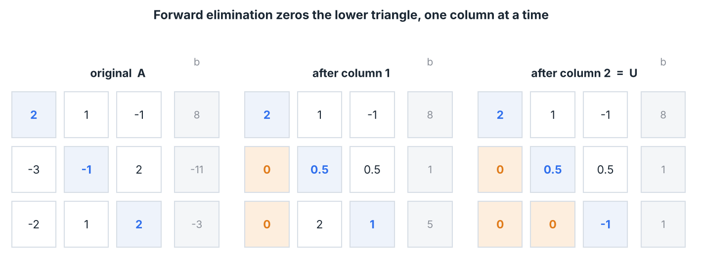
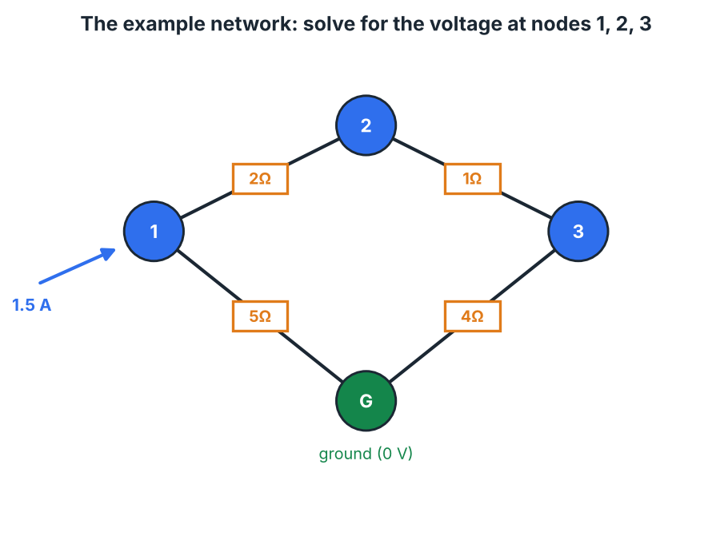

# Linear-system solver — build guide

You're going to build the routine at the center of all of numerical linear
algebra: solving `A x = b`. You'll start from the elimination you'd do by hand,
make it numerically robust, repackage it as an **LU factorization** so one
matrix can be solved against many right-hand sides cheaply, and finish by
pointing it at a real problem — a resistor network, solved exactly the way
SPICE does it.

Everything here uses only Module 2 of the linear algebra course: a matrix as a
system of linear equations, row operations, and the idea that solving a system
means reducing it to triangular form. No determinants, no eigenvalues, no
outside reading.

### What you'll have built

| Stage | Target | The idea |
|------:|--------|----------|
| 1 | `forward_eliminate` | Row-reduce `A` to upper-triangular `U`. |
| 2 | `back_substitute` | Solve a triangular system from the bottom up. |
| 3 | `gaussian_solve` | The two above + **partial pivoting** for stability. |
| 4 | `lu_factor`, `lu_solve` | Factor `PA = LU` once, reuse for many `b`. |
| 5 | `Circuit` | Assemble `G v = i` from a circuit and solve it. |

### Setup

```bash
cd linsolve
python -m pytest        # all red until you start
```

Needs Python 3.8+, `numpy`, and `pytest`. The `conftest.py` at the repo root puts
the package on the path, so nothing to install. Arrays are NumPy arrays — we use
NumPy for storage and the occasional dot product, but **you** write every
elimination loop; `numpy.linalg.solve` appears only in the tests, as the
reference answer to check yourself against.

Each stage names the test command to run. Do them in order. The solution is
yours to write — this guide gives the math and the algorithm, the skeletons give
the signatures and contracts.

---

## Stage 0 — the problem

`A x = b` asks: which combination `x` of the columns of `A` produces `b`? When
`A` is upper-triangular the answer is almost free — you read it off bottom to
top. When it isn't, the whole game is to *make* it triangular without changing
the solution, using the one move that's allowed: **add a multiple of one
equation to another.** That's Gaussian elimination. Everything else here is
either making that move safe (pivoting) or bookkeeping it so you can reuse the
work (LU).

Open `linsolve/elim.py`, `linsolve/lu.py`, `linsolve/circuit.py` and skim the
skeletons, then come back.

---

## Stage 1 — forward elimination

**The move.** To kill the entry below a pivot `U[k,k]`, subtract the right
multiple of row `k` from the row beneath it:

```
factor = U[i,k] / U[k,k]
row i  :=  row i − factor · row k        (and do the same to b[i])
```

That `factor` is chosen precisely so `U[i,k]` becomes 0. Do it for every row
below the pivot, then move to the next column. When you're done, everything
below the diagonal is 0 — the matrix is **upper-triangular**. Crucially, adding a
multiple of one equation to another doesn't change the solution set, so the
triangular system has the same `x` as the original.

**Worked, on the textbook system:**

```
A = [ 2   1  −1 | 8  ]
    [−3  −1   2 | −11]
    [−2   1   2 | −3 ]

Column 1, pivot 2:
  row2 −= (−3/2)·row1  ->  [0  0.5  0.5 | 1]
  row3 −= (−2/2)·row1  ->  [0   2    1  | 5]
Column 2, pivot 0.5:
  row3 −= (2/0.5)·row2 ->  [0   0   −1  | 1]

U = [2  1  −1 | 8]    (an upper-triangular system, same solution as A)
    [0 0.5  0.5| 1]
    [0  0  −1  | 1]
```



**Your task.** Implement `forward_eliminate(A, b)`:

- Work on **copies** (`np.array(A, dtype=float)`), don't mutate the caller's
  arrays. (A test checks this.)
- For each pivot column `k`, eliminate every row below it; apply the same
  operation to `b`.
- Return `(U, c)`.

Operating on whole row slices (`U[i, k:] -= factor * U[k, k:]`) is cleaner and
faster than looping over individual entries — but a plain inner loop is fine too.

**Checkpoint:** `python -m pytest tests/test_elim.py -k forward`

---

## Stage 2 — back substitution

Now solve the triangular system. The last equation has one unknown; solve it.
The second-to-last then has only one *new* unknown; solve it. Work upward:

```
x[i] = ( c[i] − Σ_{j>i} U[i,j]·x[j] ) / U[i,i]
```

**From the `U` above:**

```
−1·x3 = 1            -> x3 = −1
0.5·x2 + 0.5·x3 = 1  -> x2 = (1 − 0.5·(−1)) / 0.5 = 3
2·x1 + 1·x2 − 1·x3=8 -> x1 = (8 − 3 − 1) / 2 = 2
```

So `x = (2, 3, −1)`.

**Your task.** Implement `back_substitute(U, c)`: loop `i` from the last row to
the first, using the formula above. The sum over `j>i` is a dot product of a row
slice with the already-known tail of `x` (`U[i, i+1:] @ x[i+1:]`).

**Checkpoint:** `python -m pytest tests/test_elim.py -k back`

---

## Stage 3 — partial pivoting

Two things can go wrong with naive elimination, and both have the same cure.

1. **A zero pivot.** If `U[k,k]` is 0, `factor = U[i,k]/U[k,k]` divides by zero —
   even when the system is perfectly solvable. Example: `[[0,1],[1,1]]` is fine,
   but its first pivot is 0.
2. **A tiny pivot.** If the pivot is very small, `factor` is huge, and
   subtracting a huge multiple of one row from another swamps the real
   information in floating-point round-off. The answer comes out badly wrong.

**The fix — partial pivoting.** Before eliminating in column `k`, look down that
column at rows `k, k+1, …` and swap the row with the **largest-magnitude** entry
up into the pivot position (swap the matching entries of `b` too). The pivot is
now as large as possible, so every `factor` has magnitude ≤ 1 and nothing
explodes. If the best available pivot is still 0, the column is all zeros at and
below `k` — the matrix is **singular**, and you raise `ValueError`.

`np.argmax(np.abs(U[k:, k]))` gives the offset of the best row (add `k` back to
get its index).

**Your task.** Implement `gaussian_solve(A, b, pivot=True)`:

- Same elimination as Stage 1, but when `pivot` is true, do the row swap above at
  the top of each column.
- Raise `ValueError` if no nonzero pivot exists.
- Finish with `back_substitute`.

**Checkpoint:** `python -m pytest tests/test_elim.py -k solve`

This includes a zero-pivot case (passes only with pivoting) and an
ill-conditioned one with a `1e-12` pivot (pivoting keeps full accuracy; without
it you'd lose it).

---

## Stage 4 — LU factorization: factor once, solve many

Gaussian elimination mixes `A` and `b` together, so if a new `b` arrives you
redo the *entire* elimination. That's wasteful — the expensive part (reducing
`A`) doesn't depend on `b` at all. **LU factorization** separates them.

**The idea.** Every multiplier `factor` you computed in Stage 1 is a number you
could *store*. Collect them into a lower-triangular matrix `L` (with 1s on the
diagonal), keep the triangular result as `U`, and it turns out

```
A = L U
```

— `L` records *how* you eliminated, `U` records the *result*. With pivoting, the
row swaps are collected into a permutation matrix `P`, and the identity becomes

```
P A = L U
```

**Why it pays off.** Once you have `P, L, U`, solving `A x = b` for any `b` is
just two triangular sweeps — no elimination:

```
P A = L U   ⟹   L U x = P b
  1. forward-substitute   L y = P b      (L is lower-triangular, unit diagonal)
  2. back-substitute       U x = y       (U is upper-triangular)
```

Each sweep is cheap. Factor **once** (the expensive step), then solve against as
many right-hand sides as you like for a fraction of the cost. This is why
`scipy.linalg.lu_factor` / `lu_solve` exist as a pair.

**The one subtlety — pivoting and `L`.** When you swap rows `k` and `p` during
factorization, you must swap them in `U` and `P`, **and** swap the already-stored
multipliers in `L` (columns `< k` only). Those multipliers belong to their rows;
if a row moves, they move with it.

**Your task.**

- `lu_factor(A)` → `(P, L, U)` with `P @ A == L @ U`. It's Stage 3's elimination,
  but instead of touching `b` you save each `factor` into `L[i,k]`, and you track
  the swaps in `P`.
- `lu_solve(P, L, U, b)` → `x`, via the two sweeps above. (The back-substitution
  is the same `back_substitute` from Stage 2.)

**Checkpoint:** `python -m pytest tests/test_lu.py`

Checks `P A = L U` on random matrices, the shapes of `L`/`U`/`P`, a zero-leading-
pivot case, and — the payoff — one factorization reused across four right-hand
sides.

---

## Stage 5 — a tiny SPICE: solve a resistor network

Time to point the solver at something real. A circuit of resistors has a voltage
at every node, and those voltages obey one law:

**Kirchhoff's current law** — at every node, current in = current out. The
current through a resistor `R` between nodes `a` and `b` is `(v_a − v_b)/R` by
Ohm's law. Writing "net current = injected current" at every node, all at once,
gives a linear system:

```
G v = i
```

- `v` = the vector of node voltages (the unknowns),
- `i` = the vector of injected currents (from current sources),
- `G` = the **conductance matrix**, assembled from the resistors.

**Assembling `G` — the "stamp".** A resistor of conductance `g = 1/R` between
nodes `a` and `b` contributes to exactly four entries:

```
G[a,a] += g     G[b,b] += g     G[a,b] −= g     G[b,a] −= g
```

That pattern falls straight out of KCL: the current leaving `a` toward `b` is
`g·(v_a − v_b)`, which puts `+g` on the diagonal and `−g` off it, symmetrically.
Every resistor stamps its four entries; they accumulate. (Notice `G` comes out
symmetric — a fact later methods like Cholesky exploit.)

**Grounding.** One node is the reference, fixed at `0 V`. Its voltage isn't an
unknown, so you **drop its row and column** from `G` and `i` before solving, then
put it back as `0` in the answer. Without grounding, `G` is singular — voltages
are only defined up to a constant, exactly like potential energy.

**The example network** (in `examples/demo.py`): 1.5 A injected into node 1, with
resistors tying nodes 1–2, 2–3, 3–ground, and 1–ground.



Solving it gives `v₁ = 4.375 V`, `v₂ = 3.125 V`, `v₃ = 2.5 V` — and because
`solve` takes any `solver(A, b)`, you can get the identical answer through your
`gaussian_solve` or your LU pair.

**Your task.** In `linsolve/circuit.py`:

- `add_resistor(a, b, R)` — stamp the four `G` entries above.
- `reduced_system()` — return `G` and `i` with the ground node's row/column
  removed, plus the list of kept node indices. (`np.ix_(keep, keep)` indexes the
  submatrix.)

`set_ground`, `add_current_source`, and `solve` are already written — `solve`
assembles the reduced system, calls your solver, and labels the voltages.

**Checkpoint:** `python -m pytest tests/test_circuit.py`

Then run the whole thing:

```bash
python -m pytest
python examples/demo.py
```

---

## What you built, and where it goes next

You now have, from scratch, the dense direct solver that sits under
`numpy.linalg.solve`, `scipy.linalg.lu`, and the DC analysis of every circuit
simulator. Real libraries add engineering, not new ideas:

- **Voltage sources** need one extra unknown (the source current) and an extra
  equation per source — "modified nodal analysis". Same `A x = b`, bordered.
- **Symmetric positive-definite `G`** (which resistor networks always produce)
  can be factored twice as fast with **Cholesky**, `A = L Lᵀ`.
- **Big sparse circuits** store only the nonzeros and reorder to keep `L`/`U`
  sparse — that's what makes SPICE scale to millions of nodes.
- **Iterative methods** (conjugate gradient) skip factoring entirely and are the
  bridge to the least-squares and PageRank capstones later in the track.

When you're ready, push it to GitHub; the layout here (`linsolve/` package,
`tests/`, `examples/`, `docs/`) is set up for it.
