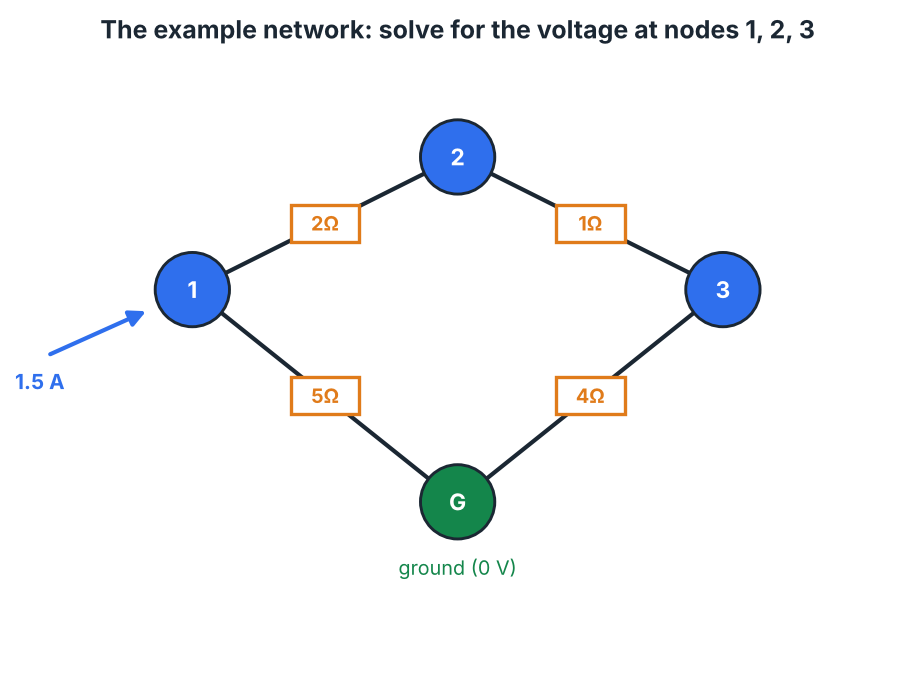
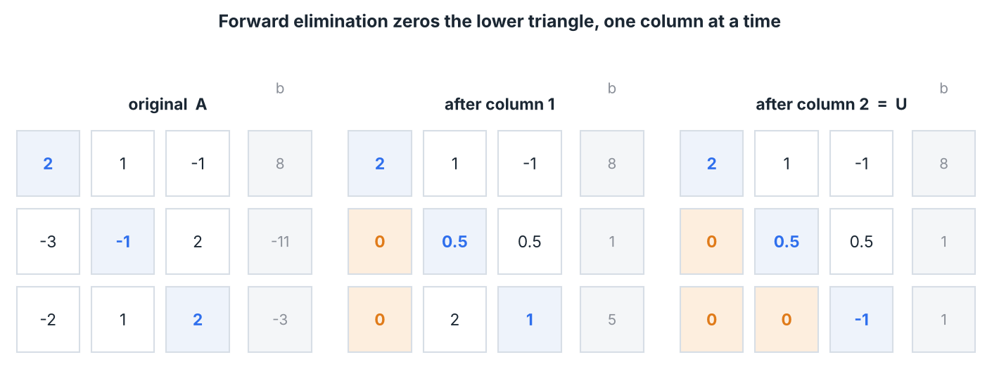

# linsolve

Build the solver at the heart of numerical linear algebra, from scratch:
Gaussian elimination → back-substitution → partial pivoting → LU factorization,
ending in a tiny SPICE that solves a resistor network for its node voltages.

A hands-on capstone for the **Linear Algebra, as Operators** course (Module 2).
It uses only what that module covers — a matrix as a linear system, row
operations, reduction to triangular form — and needs no outside material.

## What you implement

- `linsolve/elim.py` — `forward_eliminate`, `back_substitute`, `gaussian_solve`
- `linsolve/lu.py` — `lu_factor` (PA = LU), `lu_solve`
- `linsolve/circuit.py` — the conductance-matrix assembly in `Circuit`

Skeletons, signatures, and contracts are in those files; the full walkthrough is
in **[GUIDE.md](GUIDE.md)**.

## Quick start

```bash
cd linsolve
python -m pytest        # all red until you start; work stage by stage
```

Per-stage checkpoints:

```bash
python -m pytest tests/test_elim.py -k forward   # Stage 1
python -m pytest tests/test_elim.py -k back      # Stage 2
python -m pytest tests/test_elim.py -k solve     # Stage 3
python -m pytest tests/test_lu.py                # Stage 4
python -m pytest tests/test_circuit.py           # Stage 5
python -m pytest                                 # all green
python examples/demo.py
```

## The payoff

```python
from linsolve import Circuit

c = Circuit(4)
c.set_ground(0)
c.add_current_source(1, 1.5)     # 1.5 A into node 1
c.add_resistor(1, 2, 2.0); c.add_resistor(2, 3, 1.0)
c.add_resistor(3, 0, 4.0); c.add_resistor(1, 0, 5.0)
c.solve()        # {0: 0.0, 1: 4.375, 2: 3.125, 3: 2.5}
```



Elimination makes the matrix triangular; LU lets you factor once and solve many;
the circuit is the same `A x = b` wearing a different hat.



## Layout

```
linsolve/
  linsolve/      the package you implement (elim.py, lu.py, circuit.py)
  tests/         per-stage checkpoints
  examples/      demo.py — the finished thing in action
  docs/          figures used by the guide
  GUIDE.md       the staged walkthrough
```

## Requirements

Python 3.8+, `numpy`, `pytest`. (`matplotlib` only to regenerate the figures.)
`numpy.linalg.solve` is used only in the tests, as the reference answer — every
elimination loop is yours.
